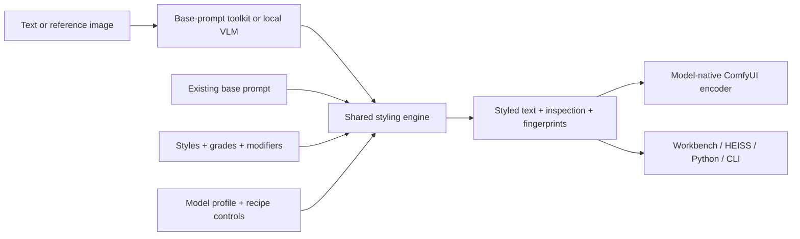

# PromptStyler Next

A modular creative styling platform for **ComfyUI**, **HEISS Studio**, and
**standalone Python workflows**. Build a scene description, combine visual
styles, and render the additions using the prompting convention of your model.

**Version 0.5.0 · 1,164 library entries · 52 packs · 11 model profiles · 6 ComfyUI V3 nodes**

The shared deterministic engine runs offline on Python 3.11+ with **zero runtime
dependencies**. Optional local MiniCPM and LFM3-VL models add base-prompt upscaling
inside ComfyUI. The engine, browser workbench, and HEISS integration all use the
same style definitions and composition logic.

This is an independent successor to
[ComfyUI PromptStyler](https://github.com/NidAll/ComfyUI_PromptStyler).

## Features at a glance

| Feature | What you can do |
| --- | --- |
| Curated style library | Explore 1,017 visual treatments, 69 color grades, and 78 modifiers across 52 versioned packs |
| Model-aware formatting | Use concise tags, natural-language additions, structured Fibo captions, or preserved edit instructions through explicit model profiles |
| Layered recipes | Combine up to 16 distinct entries, reorder layers, and adjust each layer's intensity |
| Conflict resolution | Resolve competing declared directions per visual axis with `last_wins`, `first_wins`, or `error` |
| Protected axes | Keep selected medium, lighting, palette, composition, texture, mood, or detail choices out of style additions |
| Prompt inspection | Inspect applied, skipped, duplicate, and suppressed clauses, capability warnings, normalized recipes, and fingerprints |
| Local prompt upscaling | Turn text, one reference image, or both into a semantic base using a local MiniCPM-V 4.7 1B or LFM3-VL 2B INT8 model |
| LLM metaprompt toolkit | Create, neutralize, describe, expand, edit, audit, and package reusable base prompts with seven copyable instructions |
| ComfyUI nodes | Search readable style descriptions, browse technique categories, inspect visual directions, author bases, and use native conditioning |
| Browser workbench | Search, filter, save favorites, combine styles, inspect results, and import/export recipes |
| HEISS Studio module | Browse Looks/Color/Effects, save favorites and presets, restore recipes, and inject styling through a typed bridge and managed Python service |
| Metadata recommendations | Find model-eligible entries using transparent word/tag overlap scores and matching reasons |
| Extensibility | Load custom JSON packs and explicitly register trusted Python model profiles and adapters |
| Validation and portability | Use typed immutable records, versioned JSON schemas, bounded input validation, stable errors, and independently usable Python/CLI/HTTP interfaces |



## Quick start

### ComfyUI

From your ComfyUI directory:

```sh
git clone https://github.com/NidAll/ComfyUI-PromptStyler-Next.git custom_nodes/ComfyUI-PromptStyler-Next
```

Restart ComfyUI and search for **PromptStyler Next**. Start with **Style**, enter a
scene description, choose a model profile, and open **Style explorer** to search
and inspect visual directions before applying a style. Connect the resulting
text to your workflow's native encoder.

The styling nodes need no additional runtime packages. The optional VLM upscaler
has separate [host and model requirements](docs/upscaler.md#setup-and-controls).
The complete repository supplies the current V3 extension entry point; installing
the Python wheel alone does not register ComfyUI nodes.

To also use the CLI and workbench in an existing ComfyUI virtual environment:

```sh
./venv/bin/python -m pip install ./custom_nodes/ComfyUI-PromptStyler-Next
./venv/bin/promptstyler-next serve --port 8791
```

See [ComfyUI setup, conditioning, and example workflows](docs/comfyui.md).

### Standalone Python and browser workbench

From this repository's root, using Python 3.11 or newer:

```sh
python -m pip install .
promptstyler-next serve --port 8791
```

Open [http://127.0.0.1:8791](http://127.0.0.1:8791). The installed wheel contains
the engine, style packs, schemas, HTTP service, and workbench. ComfyUI and the VLM
are optional for this route.

## ComfyUI nodes and workflows

| Node | Purpose | Outputs |
| --- | --- | --- |
| **Load Prompt Upscaler** | Load a supported local MiniCPM or LFM3-VL INT8 artifact into a cacheable, native-managed handle | Upscaler handle |
| **Upscale Base Prompt** | Author a base from text, one RGB IMAGE, or both | Base prompt, inspection JSON |
| **Preview Base Prompt** | Preview the base prompt and inspection without writing a file | UI preview |
| **Style** | Apply one style with model selection, intensity, optional negative text, and protected axes | Positive text, negative text, inspection JSON |
| **Compose Recipe** | Apply an ordered JSON recipe with conflict controls; an optional connected `prompt` overrides the recipe's base | Positive text, negative text, inspection JSON |
| **Encode Text** | Delegate tokenization and scheduled conditioning to a connected compatible native encoder | Positive and negative conditioning |

The nodes appear under **PromptStyler Next**; upscaling and conditioning have
separate subcategories. Advanced inputs keep the common styling path compact.

### Style explorer

The **Style** node has one selection control: **Style explorer**, with the current
style name on its button. Search names, descriptions, tags or IDs; filter by
Looks, Color grades or Effects; and browse grouped technique categories.
Choose a candidate, then **Apply**. Searching, changing filters or closing the
explorer keeps the current workflow selection.

Expand **Visual directions** to see the selected model's authored variant,
intensity tiers and protected axes. The original style ID remains in saved
workflows and API inputs, so existing graphs and recipes need no migration.
Refresh the ComfyUI page after updating to load the new interface.

The latest content pass refines **54 styles across seven packs**, including all
24 illustration and 24 anime looks. Low-intensity clauses now describe more
specific rendering techniques; category paths distinguish painting, drawing,
ink, paper, print and animation methods. Six scene-themed treatments also remove
instructions that could substitute scenery, weather, objects or relative scale.
Natural clauses and model-facing tags were reviewed together.

Changed pack versions intentionally change styled text and fingerprints while
retaining style IDs. For controlled composition, start with one Look and protect
palette or composition when colors or spatial relationships are required. Image
models can still add decoration or favor their trained aesthetic; these changes
do not guarantee perfect style adherence. See the [style review](docs/style-review.md)
for the content scope and paired-image evaluation limits.

Use **Encode Text** for the supported SDXL and Anima profiles with the correct
connected encoder. For FLUX, Qwen-Image, MOSS-Image, and Fibo workflows, connect the
styled STRING to the appropriate model-native encoding node. Model selection in
PromptStyler describes formatting and capabilities; it does not load diffusion
weights or choose sampling settings.

Ready-to-use examples:

- [Visual text styling workflow](examples/comfyui-text-workflow.json) and [matching API graph](examples/comfyui-text-api.json): style and recipe examples with native text previews; no model required.
- [Visual prompt upscaler workflow](examples/comfyui-upscaler-workflow.json) and [matching API graph](examples/comfyui-upscaler-api.json): MiniCPM → base prompt → Style → preview; connect Load Image for either image input mode.
- [LFM3 MOSS Base graph](examples/comfyui-lfm3-moss_image_base-api.json) and [LFM3 Anima graph](examples/comfyui-lfm3-anima-api.json): complete scene rewriting through styling and native previews; require a separately prepared local artifact.
- [Generated-caption API graph](examples/comfyui-generated-caption-api.json): feed generated text into Compose Recipe's connected prompt input.
- [SDXL conditioning API example](examples/comfyui-sdxl-api.json): replace the checkpoint placeholder with an installed model before use.

## Fast local prompt upscaling

Connect **Load Prompt Upscaler → Upscale Base Prompt → Style** or **Compose Recipe**.
Enter a short idea, connect one image, or supply both. **Expanded** is the default.
With MiniCPM, text ideas preserve your complete input and continue it with concrete
details about the existing subjects' movement, shape, pose, and relationships.
**Faithful** asks for a concise clarification with minimal additions. Reference
images remain grounded in visible content; combined input first describes the
image, then applies the user's requirements in a short text rewrite.

With **LFM3-VL 2B**, select `moss_image_base` or `anima`. It rewrites the complete
scene, developing physical form, action mechanics, contact and spatial bindings.
Curated examples teach these authoring behaviors without training the model.
Artistic direction stays with Style/Compose. See the [LFM3 guide](docs/lfm3-vl.md)
for its separate artifact, offline setup and validation limits.

The MiniCPM deployment uses this self-contained artifact:

```text
ComfyUI/models/anima_prompt_architect/minicpm-v4.7-1b-heretic-int8-convrot.safetensors
```

Its embedded tokenizer and processor assets are read locally. The MiniCPM runtime uses
native ComfyUI model management, INT8 ConvRot projections, fused DeltaNet decoding,
KV caching, greedy generation, disabled thinking, and token-based paragraph stops.
ComfyUI caches the loader and unchanged results. Editing only the style can reuse
the accepted base without running the VLM again.

| Advanced control | Default | Use |
| --- | --- | --- |
| `detail_mode` | `expanded` | Add physical detail to text ideas, or select `faithful` for concise clarification; references stay grounded |
| `max_new_tokens` | 192 | Bound output length; allowed range 32–2048 |
| `image_slices` | 1 | MiniCPM: image slices, up to four. LFM3: each unit permits up to 512×512 processed pixels while retaining aspect ratio |
| `target_model` | `moss_image_base` | LFM3 rewrite target: `moss_image_base` or `anima`; MiniCPM retains its semantic-base behavior |
| `offload_after` | false | Retain native-managed residency for repeated edits, or immediately offload after each execution |

Expanded mode can take longer than a short paraphrase. Latency varies with model
placement, input, output length and whether image grounding or repair is needed.
See the [upscaler guide](docs/upscaler.md#measured-scope-and-limitations) for
behavior and quality limits.

The accelerated deployments require a supported CUDA/Kitchen host and its
Transformers dependencies. The small VLM can miss facts or retain style language;
preview the accepted base. MiniCPM Expanded text retains any style wording already present
in the input; use the toolkit to neutralize a styled prompt first. Inspection includes timings, settings, token counts,
reference content, added-word counts, source-preservation status, and warnings. Changed quoted text and invalid output fail
explicitly. The [upscaler guide](docs/upscaler.md) covers setup, measured limits,
memory use, and the [portable benchmark](scripts/benchmark_upscaler.py).

## Reusable base-prompt toolkit

The [LLM toolkit](llm-prompts/README.md) helps keep scene content separate from
optional visual direction. Copy a metaprompt into your preferred LLM and replace
its input block with your request.

| Task | Metaprompt |
| --- | --- |
| Develop an idea into a semantic base | [Create a base](llm-prompts/01-create-base.txt) |
| Remove optional aesthetics from an existing prompt | [Neutralize a prompt](llm-prompts/02-neutralize-prompt.txt) |
| Describe visible reference content | [Describe a reference](llm-prompts/03-describe-reference.txt) |
| Add scene detail with explicit permission for additions | [Expand a scene](llm-prompts/04-expand-scene.txt) |
| Preserve reference content while requesting a change | [Write edit instructions](llm-prompts/05-edit-instruction.txt) |
| Check missing facts and unwanted style constraints | [Audit a base](llm-prompts/06-audit-base.txt) |
| Turn a base and known catalog IDs into recipe JSON | [Build a recipe](llm-prompts/07-build-recipe.txt) |

Keep entity counts, actions, identity colors/materials, spatial relationships, and
exact lettering in the base. Choose rendering medium, artistic lighting, global
palette, surface treatment, and mood through style layers. The toolkit includes
[a six-scene corpus and replay recipes](llm-prompts/examples/README.md).

Paste only the accepted base into Style or Compose Recipe. Audit reports are
separate authoring output; LLM-generated recipes still require engine validation.

## Style library and composition

The library contains **1,164 entries across 52 packs**:

| Kind | Entries | Role |
| --- | ---: | --- |
| Visual treatments | 1,017 | Establish a recognizable medium or aesthetic |
| Color grades | 69 | Supply a palette direction |
| Modifiers | 78 | Adjust specific lighting, texture, composition, or detail choices |

Coverage includes cinematography, photography, anime, manga, illustration, fine
art, printmaking, historical media, graphic design, 3D, architecture, concept art,
regional crafts, fashion, textiles, botanical and culinary imagery, typography,
technical diagrams, analog horror, retro media, gaming eras, internet aesthetics,
and experimental approaches.

Recent focused packs add **Computational Surfaces**, **Optical Material Accents**,
**Animation Finishing**, and **Information Hierarchy**. Entries carry stable IDs,
descriptions, categories, search tags, model eligibility, axis claims, and prose/tag
clauses with authored intensity thresholds. See the [complete library inventory](docs/style-library.md)
and [style review](docs/style-review.md).

Composition operates on seven axes: **medium, lighting, palette, composition,
texture, mood, and detail**.

- **Layer order and conflicts:** choose `last_wins`, `first_wins`, or `error` for competing declared claims. Only the conflicting axis is suppressed, so a grade can replace a palette while retaining a medium.
- **Intensity:** each layer activates curated clause tiers between 0 and 1. Zero bypasses that layer. Intensity is a semantic detail control, not an embedding weight or sampler strength.
- **Protected axes:** `locked_axes` suppresses style clauses on selected axes so those directions remain under your control.
- **Model variants and negatives:** exact profile variants can supply different authored clauses. Unsupported negative text remains in the recipe and produces a capability warning.
- **Inspection and replay:** every applied, skipped, duplicate, or suppressed clause has a trace entry. Save the recipe, catalog snapshot, and matching engine/adapter version to reproduce its text output.

The deterministic engine preserves the supplied base verbatim in prose/tag
profiles. Fibo maps it into caption fields while preserving supplied caption data.
Declared claims and explicit locks govern composition; the engine does not parse
free-form scene contradictions or verify generated pixels.

## Model profiles

Select the profile for the actual workflow. Profiles control system-added text,
negative-prompt handling, and conditioning eligibility.

| Profile ID | Added language / output | Text negatives | Conditioning handoff |
| --- | --- | --- | --- |
| `generic` | Conservative natural prose; unknown-model fallback | Suppressed | Model-native encoder |
| `sdxl` | Concise tags | With CFG | Encode Text or native SDXL nodes |
| `flux` | Natural prose | Suppressed | Native FLUX workflow |
| `qwen-image` | Natural prose | With enabled CFG | Native image-aware workflow |
| `qwen-image-2.1` | Natural prose | Suppressed for CFG-free default | Native image-aware workflow |
| `moss-image` | Natural prose | With CFG | Native MOSS workflow |
| `moss-image-dmd` | Natural prose | Suppressed at CFG 1 | Native MOSS workflow |
| `anima` | Lowercase spaced tags | With CFG | Encode Text or native Anima workflow |
| `anima-turbo` | Lowercase spaced tags | Suppressed at CFG 1 | Encode Text or native Anima workflow |
| `fibo` | Structured JSON caption fields | Unsupported by the text interface | Native Fibo encoder |
| `fibo-edit` | Preserved edit instructions or caption JSON | Suppressed | Native Fibo edit workflow |

Fibo generation places the base in `short_description` and maps explicit style
axes into caption fields; supplied caption fields take precedence. Fibo edit keeps
plain instructions or existing caption structures, including `edit_instruction`.
Unknown model identifiers fall back to `generic` with a warning.

Profiles describe documented workflow conventions and curated variants. Fine-tunes
can behave differently. See [model sources, assumptions, and extension rules](docs/models.md).

## Browser workbench and HEISS Studio

The local workbench provides searchable categories, tags, model/type filters,
favorites, metadata recommendations, ordered layers, per-layer intensity,
protected axes, conflict controls, positive/negative previews, inspection, and
recipe import/export. Filter URLs can be bookmarked. Favorites persist in browser
storage; the service stores no prompt history. Abstract swatches identify entries
and are labeled as swatches rather than generated-image examples.

The reusable HEISS integration supplies:

| Module | Purpose |
| --- | --- |
| `studio/client.mjs` and TypeScript declarations | Typed discovery, profiles, composition, and recommendation transport |
| `studio/react-panel.mjs` and `panel.css` | React composer panel using the host's React instance, with search, favorites, layers, intensity, and inspected previews |
| `studio/bridge.mjs` | Express-compatible bridge behind the host's access guards |
| `studio/server.mjs` | Lazy owned Python sidecar with readiness checks and lifecycle cleanup |
| `studio/model-profile.mjs` | Explicit HEISS workflow metadata → engine profile mapping |
| `studio/graph.mjs` | Insert Compose Recipe between a mapped prompt/caption and its native encoder |

The responsive style browser offers Looks, Color, Effects, Saved and Presets.
Search matches words across metadata and ignores accents. Favorites, named
presets and per-workflow selections persist in browser storage and synchronize
between tabs on the same origin. Replay helpers restore ordered strengths,
protected axes, paused state and mixing controls.

Fresh generation requests carry validated recipes; retry handling avoids applying
styles repeatedly. Image-derived captions can be styled after caption generation.
The reviewed local Studio integration supports Anima Image Clone, MOSS Flash/Detail,
and Fibo 2 Edit Turbo. Its model encoders and workflow controls remain native.

HEISS requires an explicit server/panel integration; it has no general third-party
style plugin loader. See [the HEISS integration guide](docs/studio.md) for mounting,
request hooks, managed service configuration, and generation contracts. The optional
MiniCPM and experimental LFM3 authoring runtimes are exposed through ComfyUI nodes.

### HTTP interface

The workbench and Studio use the versioned local API:

| Method | Route | Result |
| --- | --- | --- |
| GET | `/api/v1/health` | Health, schema version, catalog fingerprint |
| GET | `/api/v1/catalog` | Inventory, categories, kinds, catalog fingerprint |
| GET | `/api/v1/profiles` | Profile capabilities and metadata |
| GET | `/api/v1/styles` | Search/filter/paginated style metadata |
| GET | `/api/v1/styles/{id}` | Complete style metadata |
| POST | `/api/v1/compose` | Positive/negative text, recipe, trace, warnings, fingerprints |
| POST | `/api/v1/recommend` | Metadata-ranked suggestions with reasons |

The loopback service uses bounded JSON, strict Host/Origin checks, a fixed static
asset allowlist, and structured errors. It has no model-download or pack-upload
endpoint. JavaScript transports recipes and results; Python owns styling logic.

## Python API and CLI

```python
from promptstyler_next import Engine

engine = Engine.builtin()
styles = engine.list_styles(query="gouache", model="anima", kind="style")
suggestions = engine.recommend(prompt="botanical ink illustration", model="anima", limit=6)

result = engine.compose(
    {
        "schema_version": 1,
        "prompt": 'A heron beside a ceramic bowl marked "雨"',
        "model": "anima",
        "styles": [
            {"id": "illustration.gouache", "intensity": 0.75},
            {"id": "grade.sage", "intensity": 0.6},
        ],
        "conflict_policy": "last_wins",
        "locked_axes": ["composition"],
    }
)

print(result.positive)
print(result.negative)
print(result.to_dict()["trace"])
print(result.fingerprint)
```

Typed `Recipe`, `Layer`, `Composition`, and `Profile` records are available for
Python callers. Results include the normalized recipe, resolved profile, warnings,
structured inspection, a composition fingerprint, and a catalog fingerprint.
`StylerError` exposes stable `code`, `message`, and `path` fields.

```sh
promptstyler-next styles --query noir --model flux
promptstyler-next styles --category illustration --kind style --limit 20
promptstyler-next profiles
promptstyler-next compose examples/recipe.json
promptstyler-next recommend 'botanical ink illustration' --model anima
promptstyler-next validate ./my-pack.json
promptstyler-next --pack ./my-pack.json serve --port 8791
```

Discovery, composition, validation, and recommendation commands emit JSON.
`compose` also reads a recipe from stdin; repeatable
`--pack` options appear before the subcommand. The [Python API guide](docs/api.md)
covers pagination, immutable snapshots, errors, and adapter registration.

## Custom styles and model adapters

Add a versioned JSON pack with original style text and metadata. Each entry defines
its kind, category, tags, model restrictions or variants, axis claims, and clauses
with natural-language text, optional tags, and intensity thresholds.

| Consumer | Load a pack |
| --- | --- |
| ComfyUI | Place `.json` files in this repository's `custom_packs/`, then restart ComfyUI |
| Python | `Engine.builtin().with_packs(["./my-pack.json"])` |
| Custom-only Python catalog | `Engine.from_packs(["./my-pack.json"])` |
| CLI / workbench | `promptstyler-next --pack ./my-pack.json serve --port 8791` |

Edited packs produce a new validated catalog snapshot. Duplicate IDs, unknown
fields, invalid model references, unsupported schemas, and malformed/non-finite
values fail with actionable errors. Packs are bounded data and cannot import code,
evaluate templates, or fetch remote assets. Preview paths remain constrained
metadata; the service does not expose arbitrary files.

For another model convention, explicitly register a trusted `Profile` and
`ModelAdapter`. Adapters format engine-owned additions and declare their revision;
pack JSON cannot register Python code. Read [pack authoring](docs/packs.md),
[adapter examples](docs/api.md#add-a-model-adapter), and the [architecture](docs/architecture.md).

## Development and validation

```sh
python -m pip install -e '.[dev]'
python -m coverage run -m pytest --ignore=tests/test_comfy.py
python -m coverage report --fail-under=85
ruff check .
ruff format --check .
mypy
node --test studio/tests/*.test.mjs
python scripts/audit_library.py --check
python -m build
python scripts/check_distribution.py dist
```

The current local checks pass **231 standalone Python tests**, **67 ComfyUI host
contract tests**, **9 CPU LFM3 runtime tests**, and **24 Node/Studio tests**, with
**93% core statement/branch coverage**. Lint, formatting, strict core typing and
the bundled-library audit also pass. Packaging checks compare archive contents
with source and exercise an installed wheel outside the checkout.

Host tests require ComfyUI's environment. The standalone suite skips optional
Torch runtime and CUDA modules when unavailable; two additional LFM3 CUDA tests
require explicit opt-in. CI covers Python 3.11–3.14, property/schema/HTTP contracts,
Studio transport, pinned CPU host registration, typing and distribution checks.
LFM3 graph validation uses a tiny temporary metadata artifact, so CI needs no
installed model weights. See [validation scope](docs/validation.md) for recorded
inference and quality limits. Generated-image fidelity and universal aesthetic
quality require separate evaluation.

## Documentation and licensing

| Guide | Contents |
| --- | --- |
| [ComfyUI](docs/comfyui.md) | Nodes, native encoders, custom packs, and workflows |
| [Experimental LFM3-VL](docs/lfm3-vl.md) | Separate artifact, offline preparation, targets and rewrite limits |
| [Local prompt upscaler](docs/upscaler.md) | Model requirements, controls, performance, and limits |
| [Base-prompt toolkit](llm-prompts/README.md) | Seven metaprompts, semantic handoff, and examples |
| [Style library](docs/style-library.md) | Inventory, creative domains, authoring, and previews |
| [Model profiles](docs/models.md) | Conventions, capabilities, sources, and evidence |
| [HEISS Studio](docs/studio.md) | Panel, bridge, sidecar, HTTP API, and generation hooks |
| [Python API](docs/api.md) | Public contracts and extension examples |
| [Pack format](docs/packs.md) | JSON schema, variants, claims, limits, and contribution rules |
| [Architecture](docs/architecture.md) | Module boundaries, composition, and reproducibility |
| [Development](docs/development.md) | Environments, quality gates, and packaging |
| [Validation](docs/validation.md) | Recorded checks and acceptance boundaries |
| [Reference audit](docs/reference-audit.md) | Original project and HEISS design findings |

Code is [Apache-2.0](LICENSE). Bundled style definitions and the original LLM
prompt toolkit are [CC0-1.0](STYLE-LICENSE); contributed packs retain their declared
licenses. Third-party implementation attribution is in [NOTICE](NOTICE). Model
weights are distributed separately under their own licenses.
