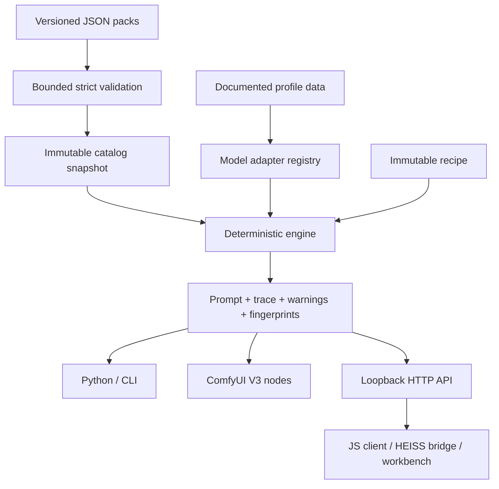

# Architecture

The optional `comfyui/upscaler/` authoring stage is upstream of this deterministic
engine. It owns pinned local MiniCPM code, embedded-asset validation, native
ModelPatcher placement and serialized generation. Its loader handle is cached by
ComfyUI; no global model/tensor cache or model import enters `promptstyler_next/`.
The only handoff to the engine is the accepted base STRING. The standalone HTTP
service and Studio integration do not load the VLM. See [upscaler](upscaler.md).

## Ownership

`types.py` defines immutable recipe, clause and result records. `validation.py`
owns JSON bounds and primitive checks. `catalog.py` validates and indexes packs.
`adapters.py` owns profile capabilities and generated-text formatting. `engine.py`
selects clauses, resolves claims and explains composition. These modules import
only Python's standard library. Neither ComfyUI nor the HTTP server is imported
by the public engine package.

`comfyui/` owns host schemas and native encoding delegation. `service.py` owns
request parsing, local access checks and HTTP status codes. `studio/` owns the
transport bridge and declarations. The browser workbench owns view state and
favorites. No host, session, request, gallery or model-loading context enters the
engine. JavaScript never implements a second composition algorithm.

## Composition contract

1. Validate schema, text, layer IDs, finite intensities and supported model claims.
2. Resolve the explicit model ID/alias, otherwise warn and use the generic profile.
3. Select each profile variant, if present. Apply intensity thresholds and protected
   axes. Existing Fibo caption fields automatically protect their axes.
4. Resolve incompatible *declared* claims per axis in recipe order. Identical claim
   identities are compatible. Builtin full looks use distinct medium/texture
   identities; grades and modifiers remain independently composable. Unclaimed clauses remain additive. Error policy
   reports the axis before producing an ambiguous result.
5. Remove identical generated clauses without rewriting the user subject. Record
   every decision. Distinct prose with similar meaning is not silently rewritten.
6. Render through the selected adapter. Add supported negative phrases only from
   contributing styles. Unscoped negatives from partially active
   styles are omitted with a warning, preventing stale negative instructions from
   fighting the winning positive layer. User negative text is never rewritten.
7. Return an immutable result, canonical recipe, structured inspection and SHA-256
   fingerprints.

Intensity is discrete semantic detail, not a calibrated aesthetic strength or
linear interpolation of images. Clauses active at a threshold stay active at
higher intensities. Conflict changes may still change the final text nonlinearly.

No local NLP model guesses whether the subject's red coat contradicts a warm grade.
The subject is protected verbatim; explicit locks and declared claims make that
choice controllable and explainable. Optional AI assistance can propose a recipe
outside the engine, then pass through the same validation. None is bundled or
required.

## Reproducibility and performance

A catalog fingerprint covers canonical pack content, model profile data, adapter
revisions and engine protocol revision. A composition fingerprint additionally
covers the normalized input recipe and actual positive/negative output. Paths,
file timestamps, random seeds, wall time and machine state do not affect either.
To replay exactly, retain the recipe, catalog snapshot and matching code/adapter
version. A fingerprint detects changes; it cannot recover missing pack content.

Builtin JSON is parsed once per process. Engine instances hold immutable tuple
records and private lookup indexes. Discovery uses an index of Unicode metadata
tokens; recommendations rank metadata overlap with tag boosts, then stable ID
ties. These scores are transparent text relevance, not image-quality estimates.
Composition uses small local collections and supports concurrent calls without
locks or shared mutable workspaces. Results expose defensive JSON copies.

Custom packs produce a new engine snapshot. The running service and ComfyUI node
catalog never partially reload while another request is composing. Restart the
owning integration to adopt edited files.

## Trust boundaries

Packs can supply visual text, metadata and relative raster preview references.
They cannot supply Python modules, expressions, fetch URLs, filesystem operations
or executable formatting. JSON duplicate keys, non-finite/oversized numbers,
excessive nesting, invalid identifiers and unknown schema fields fail. Preview
paths cannot traverse directories and are never exposed as HTTP file routes.

The HTTP service is a local sidecar, with a fixed asset allowlist, strict
Host/Origin checks, request limits and no permissive CORS. The HEISS bridge belongs
behind the host's request guard and sign-in. Logs exclude prompt payloads and query
text. Limits and error codes are documented at their public boundaries.
