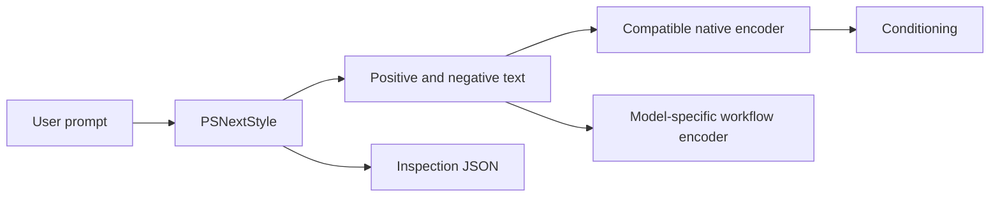

# ComfyUI integration

Clone this repository into `ComfyUI/custom_nodes/ComfyUI-PromptStyler-Next` and restart ComfyUI. The nodes use the current V3 `comfy_entrypoint` API; there are no V1 mappings or legacy nodes. The deterministic engine has no runtime dependencies to install. Installing the Python wheel alone does not register custom nodes: ComfyUI loads the repository entry point.

## Choose a workflow

| Node | Use | Outputs |
|---|---|---|
| **PromptStyler Next: Load Prompt Upscaler** | Load a local MiniCPM-V 4.7 1B or LFM3-VL 2B INT8 artifact once; native model management owns placement | Cached upscaler handle |
| **PromptStyler Next: Upscale Base Prompt** | Expand a text idea or choose Faithful clarification; accept one image or both; see [setup and measured performance](upscaler.md) | Base prompt, inspection JSON |
| **PromptStyler Next: Style** | Pick one style, profile, and intensity; optional negative text and protected axes are under advanced inputs | Positive text, negative text, inspection JSON |
| **PromptStyler Next: Compose Recipe** | Compose ordered layers with explicit conflict policy using recipe JSON | Positive text, negative text, inspection JSON |
| **PromptStyler Next: Encode Text** | Convert the two text outputs using a compatible native text encoder | Positive conditioning, negative conditioning |

Use **Style explorer** for metadata search, readable category groups, and separate
Looks, Color grades and Effects filters. Each result describes its visual identity;
expand **Visual directions** to inspect the selected model's authored variant,
intensity tiers and protected axes. Choose a candidate, then **Apply** to change the
node. Closing the browser leaves the workflow selection intact.

The explorer button displays the selected style name. Category and style dropdowns
are absent from the node; category filters live inside the explorer. Choose **All
categories** there to browse the full catalog. The selected full ID is still saved
and sent for execution, so workflows, API graphs and recipes need no migration.
Loading or cloning restores the selected style and its button label. Search and
category filters are browsing state, excluded from execution and saved widget values.
Custom packs use their catalog categories automatically after the usual restart
to load pack changes. Refresh the frontend after installing this extension update.

Use the Studio browser or `Engine.list_styles()` for descriptions and metadata. Select a style compatible with the chosen model; an unsupported model restriction raises a descriptive validation error. The optional `locked_axes` field keeps style clauses from introducing instructions on an axis already specified in your prompt. It does not infer your intent from free text.

Intensity activates curated clause tiers. Zero bypasses a layer. Increasing intensity adds author-selected visual instructions; it does not interpolate embeddings, alter sampler settings, insert token weights, or promise a linear image change.

For a coherent result, start with one Look. Use a Color grade or Effect only for
an intentional additional direction. Protect **palette** for required identity
colors and **composition** for fixed placements or relationships. The node keeps
the supplied prompt intact; it cannot infer every conflicting instruction in prose
or guarantee the image model follows the style. Technique detail gives the model
more specific guidance, rather than a longer list of quality adjectives.



## Native conditioning

`PSNextEncode` delegates directly to the connected encoder's `tokenize` and `encode_from_tokens_scheduled` methods, matching ComfyUI's normal text encoding path. It does not load a checkpoint, move tensors, patch a model, cache embeddings, or own offloading. You must connect an encoder loaded for the selected model; a profile selection cannot identify the actual model inside a CLIP object.

The initial direct encoding profiles are SDXL and Anima. SDXL uses the same text for its two encoders and their native defaults. Use ComfyUI's dedicated SDXL encoder when you need separate local/global prompts or resolution metadata. Anima uses the native dual-tokenizer path; the styling engine does not invent universal token-weight semantics.

For FLUX, Qwen-Image, MOSS-Image, and Fibo, connect the **string** outputs to the workflow's native encoding node. These model families can require model-specific guidance, image/reference inputs, chat templates, or scheduled text-image conditioning. `PSNextEncode` refuses specialized profiles even when an API client bypasses the dropdown.

| Workflow | Recommended handoff |
|---|---|
| FLUX | Native `CLIPTextEncodeFlux` (original FLUX models) or the encoder recommended for the exact FLUX generation; keep workflow guidance settings |
| Qwen-Image edit / 2.1 | `TextEncodeQwenImageEdit`, `TextEncodeQwenImageEditPlus`, or `TextEncodeQwenImage21`, preserving reference and VAE inputs |
| MOSS-Image | Existing model workflow encoder; preserve layout/control steps. Edit workflows use `TextEncodeMOSSImageEdit` |
| Fibo 2 | `TextEncodeFibo2`; supply the positive caption text and preserve native latent/reference outputs |

Fibo's structured profile can emit a native JSON caption. Keep that output intact and pass it to the native Fibo node; do not wrap JSON inside another prompt or send generic inspection JSON to an encoder.

Negative support describes the selected inference profile, not every possible checkpoint in a family. Unsupported negative text is retained in the recipe and explained in warnings rather than silently used as positive text. Distilled/Turbo profiles can differ from their base models.

## Examples

- `examples/comfyui-upscaler-workflow.json`: importable visual text-to-base-to-style graph. Connect Load Image to its optional image socket for either image input mode.
- `examples/comfyui-upscaler-api.json`: equivalent executable API graph, requiring the existing MiniCPM model.

- `examples/comfyui-text-workflow.json`: importable visual graph with style and recipe examples plus native text previews. It needs no models.
- `examples/comfyui-text-api.json`: matching API graph; send it as the `prompt` field of a normal ComfyUI `/prompt` request.
- `examples/comfyui-sdxl-api.json`: generation graph showing native conditioning. Replace `SELECT_YOUR_SDXL_CHECKPOINT.safetensors` with an installed SDXL checkpoint before use. This graph is a wiring example, not a tested image-quality preset.

The text example uses `PreviewAny`, shipped by current ComfyUI as **Preview as Text**, to show the styled prompt and inspection. Inspection includes normalized recipe, content fingerprints, capability warnings, and clause-level transformation reasons. Store the inspection alongside an image to reproduce the styling decision.

## Custom packs

For input prompts that leave artistic choices to the node, use the
[semantic base toolkit](../llm-prompts/README.md). Paste only the generated base
into the Style prompt or Compose Recipe's `prompt`; the audit metaprompt returns
an authoring report, of which only `base_prompt` is image content.

Place valid JSON packs directly in this repository's `custom_packs/` directory and restart ComfyUI. The engine loads them into one immutable catalog. Duplicate definitions and invalid packs fail visibly. Symlinks are refused. Node inputs never select arbitrary files; no frontend input can execute pack code or trigger a download.

The same files can be loaded by standalone Python using `Engine.builtin().with_packs([...])` or passed to the Studio sidecar's pack configuration. Keep private packs out of Git. Changes require a ComfyUI restart; changing a pack on disk during an execution does not alter that execution's catalog.

## Host integration validation

Run the tests with your host Python and ComfyUI source directory:

```bash
PYTHONPATH=/path/to/ComfyUI /path/to/ComfyUI/venv/bin/python -m pytest tests/test_comfy.py -q
node --test tests/*.test.mjs
```

These tests load the real V3 API, validate registration and schemas, compare node outputs against the shared engine, reject untrusted inputs, and exercise native-encoder delegation with an explicit test double. The suite skips when the host API is absent. It does not generate images or establish image-quality equivalence between model profiles.

API graphs wrap array-valued widgets as `{"__value__": []}` (or a selected list),
because a raw list is reserved for graph links. The bundled API examples use this
native literal wrapper. Recipe JSON itself uses ordinary arrays; it is a string
input, independent of ComfyUI's graph-link representation.

## Generated caption input

`PSNextCompose` accepts an optional advanced STRING input named `prompt`. When
connected, it replaces only the recipe's prompt before composition. This permits
an image captioner to feed the same engine used by Studio while retaining the
native text encoder. See [the model-free linked-caption API example](../examples/comfyui-generated-caption-api.json).
