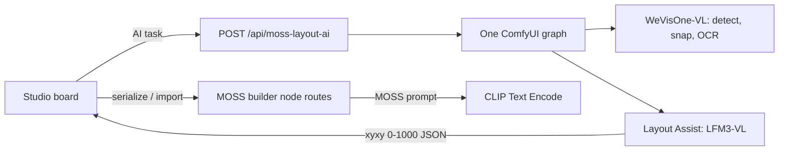

# MOSS layout pipeline

How a MOSS-Image layout prompt is built, by hand or with AI help, and what was done to make each step fast.
Three projects take part:

| Part | Where | Job |
| --- | --- | --- |
| MOSS Image Layout Prompt Builder | [ComfyUI-Ming-Image-Prompt-Builder](https://github.com/NidAll/comfyui-ming-image-prompt-builder) (`moss.py`) | The only serializer: validates boxes, writes the official MOSS layout JSON, imports compiled prompts, drafts, Ideogram 4 JSON and 0–1000 assistant layouts |
| Layout Assist + LFM3 decode engine | this repository (`comfyui/upscaler/layout_assist.py`, `comfyui/upscaler/lfm3/engine.py`) | Writes layout JSON with LFM3-VL: lists objects, captions boxes, plans a layout from an idea, edits one by instruction |
| Studio builder overlay | this repository ([studio/moss-layout/](../studio/moss-layout/README.md)) | Browser editor and the HEISS routes that queue the AI graphs |

Box detection (objects and lettering) and the separate Read lettering action use ComfyUI core's
**WeVisOne-VL Detect** node. Plain-text prompt expansion stays with
the [MOSS Prompt Upsampler](moss-upsampler.md); LFM3-VL handles everything that is JSON.

## Data flow



Coordinates have one form between the models and the board: `[x1, y1, x2, y2]` on a 0–1000 grid, items listed
back to front, with `"grid": "xyxy-1000"`. The builder node converts that onto the canvas
(MOSS: `[y_min, x_min, y_max, x_max]` in pixels from the canvas centre). Ideogram 4 JSON
(`[ymin, xmin, ymax, xmax]` on 0–1000, first element in front) goes through the same import, and the board
can copy a layout out as Ideogram 4 JSON.

## Tasks

Each AI action is one queued graph. Its steps are reported live and shown in the card.

| Task | Graph | Result |
| --- | --- | --- |
| `image`: extract layout + prompt | LFM3 `list_objects` → WeVisOne `detection` (objects, plus `title`/`text` when the list saw lettering) → LFM3 `describe_regions` | Boxes, captions, summary with a background sentence, style tags, lettering words |
| `describe` | LFM3 `describe_regions` (with the reference if there is one) | Captions for the given boxes; a rewrite keeps the box's subject |
| `text` | LFM3 `text_layout` | A layout from an idea: 2 to 6 boxes, the setting in the summary |
| `edit` | LFM3 `edit_layout` | The instruction's changes, applied in code; locked boxes stay |
| `snap` | WeVisOne `referring` | The selected box fitted to the object its caption names |
| `ocr` | WeVisOne `ocr` | One text box per line of lettering |

## What gets a box

A MOSS layout works best with few boxes: the subject, the objects that matter and the lettering. Everything
else is the setting and belongs in the summary. `layout_assist.select_regions` sorts detector boxes into
*things* (boxed) and *stuff* (named in the background sentence):

- **Subject first.** The first label the list asks for is the subject: up to five instances are kept, people
  and animals before props. Every other label keeps at most two similar-sized instances.
- **Setting is background.** Scenery nouns (sky, forest, wall, floor, shelves, buildings, table…) and any big
  box touching two frame edges go to the background unless they are the subject ("cathedral").
- **Patterns are background.** Four or more instances of one label spread over a third of the frame (roses
  all over, trees of a forest, a city's buildings) become one background mention, not boxes.
- **Small repeats group.** Three or more small instances close together (a crowd under a hero) become one
  box with a count; scattered ones go to the background.
- **Parts and contents go.** Armour on a knight, the spires of a cathedral and the jars inside a cart are
  covered by the caption of the box that holds them. What the subject holds stays boxed.
- **Duplicates go.** The same thing found under two names ("flower vase", "vase") is boxed once.
- **Lettering is found, not read twice.** `title`/`text` boxes from the same detector call are merged into at
  most three reading-order blocks; LFM3 reads their words while it captions (`"words"`), so there is no OCR pass.

The list answers `{"subject", "objects", "background", "lettering"}`. Its background nouns and the names of
everything dropped above reach the describe prompt as "No box (background): …", and the describe answer's
`"background"` sentence is appended to the summary. Creature and fantasy-being nouns (goblin, troll, elf…)
import as Character boxes.

## Edits

A 2B model asked for coordinates or the whole layout copies the boxes back unmoved. `edit_layout` therefore
shows each item with its place in words ("2. sleeping cat (bottom left)") and asks for changes in words:

```json
{"changes": [{"item": 1, "place": "bottom"}, {"item": 3, "caption": "..."}, {"item": 2, "remove": true},
             {"add": "lamp", "caption": "...", "place": "right", "size": "small"}],
 "summary": "only when the scene changes"}
```

`apply_edit` does the geometry (nine places, nudges, bigger/smaller, sizes for new boxes) and guards against
the model's habits: a change applies only when the instruction asks for that kind of change, only to the items
it names, and a restated place leaves a box where it is. Captions that describe the change ("moved to the
left") are ignored, a trailing detail ("wearing a red coat") joins the old caption, and the summary is kept
true: clauses about removed items go, new words replace old ones, a moved item's place phrase follows its box.

## Answer format

- Captions come back under numbered, quote-free keys (`"1 dog": "..."`), so each caption lands on its own box
  even if the model reorders them.
- Answers are repaired leniently and never retried. A describe answer with a stray quote is salvaged field
  by field, and gaps are filled the same way.
- Captions that echo the label or the box are cleaned up (`_unecho`).
- Meta tags that repeat an item's label or text are dropped, so meta stays style and medium.
- A rewrite passes the box's current caption as a hint, so a lone box keeps its subject.

## Speed work

- **LFM3 decode engine.** The Transformers generate loop is launch-bound at batch size 1. The engine
  prefills eagerly, then replays one captured CUDA graph per token, with fixed KV for full-attention layers,
  a 256-slot ring for sliding-window layers and a 6-tap state for short-convolution layers. It checks the
  stop condition on the host every 8 tokens. In our tests this decoded about three times faster than the
  Transformers loop; the gain depends on the GPU. Output is not bit-identical: teacher-forced argmax agreed
  99.2% of the time on text and 95.4% with an image. Details are in [lfm3-vl.md](lfm3-vl.md#fast-decode-engine).
  The engine lives on the loader's handle, is recaptured when the weights move, and leaves no model-owned
  caches.
- **One LFM3 call per image.** The describe step sees the full image plus box coordinates. Per-box crops
  were slower and miscounted.
- **One detector call.** Lettering is found by the same WeVisOne detection call as the objects (`title`/`text`
  labels) and read by LFM3 while it captions, so the image task is LFM3 → WeVisOne → LFM3 with no OCR node.
  Swaps dominate the image task when both models do not fit in VRAM together. The describe node keeps its lazy
  `words` input for graphs that still wire OCR.
- **Bounded detector answers.** WeVisOne `max_length` is capped per task (detection 256, referring 160,
  OCR 640 tokens). The subject comes first in the query, so the cap only trims the long tail of minor labels.
- **Short edit answers.** Worded changes are a few dozen tokens instead of a rewritten layout.
- **Result cache.** Results are keyed by the task, its settings and the image bytes (SHA-256), with 40
  entries. Asking again answers at once. *Another take* skips the cache and samples at temperature 0.5 with
  a new seed; other requests decode greedily.
- **Small uploads.** The reference is sent as the board shows it, at most 896 px, as JPEG.
- **Cheap progress.** The browser polls the job every 150 ms. The server follows ComfyUI's websocket for
  the active node and the token count, so no extra model work happens for progress.

On 14 test renders the second pass made the image task about a fifth faster end to end and cut the boxes by
about 40% (single greedy runs on one GPU; the ratio depends on the hardware and on model swap cost).

## Limits

- Caption and layout quality was checked on 14 renders and five edit instructions, not a benchmark.
- The detector can miss small subtitle lettering or merge close instances; OCR can misread stylized lettering.
- Edits understand places, sizes, captions, words, removals and additions; finer geometry ("a bit to the
  left of the lamp") is not modelled.
- The effect of AI-made layouts on generated MOSS images has not been evaluated.
