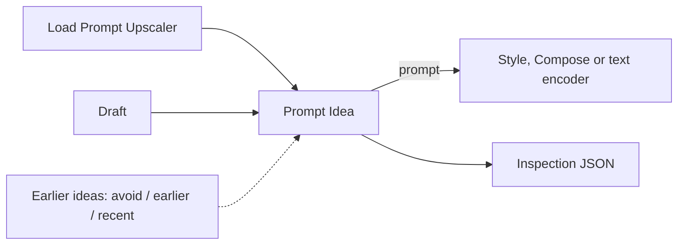

# Prompt ideas (experimental, LFM3-VL)

**PromptStyler Next: Prompt Idea** turns a draft into a new, fully written prompt idea.
Run it again with another seed and you get a different idea from the same draft. It is
the creative counterpart of [Upscale Base Prompt](lfm3-vl.md), which deliberately adds
nothing new.

## What one run does

1. **Plan (seeded, no model).** It picks one *lens*: Setting, Time and weather, Light,
   Viewpoint, Moment, Color, Materials, Companion, Story details, Motion or Emotion. It also
   picks a *structure*: Cinematic shot, Layered depth, Story moment, Subject spotlight,
   Atmosphere first, Photo brief, Wide to detail, Contrast or Composition. Lens and
   structure keys named in `recent` are skipped while others remain. Wild exploration pairs
   a bold lens (Scale, Era, Genre, Twist or Medium) with a second, ordinary one. Each lens
   adds a few seeded concrete *sparks* (for example "light through stained glass"), so a
   small model does not fall back on the same stock answer every time.
2. **Brainstorm.** The model writes three (Explore) or four (Wild) one-sentence concepts. It
   samples 0.2 hotter than the final prompt and is told the earlier ideas, listed without
   their quoted words.
3. **Pick.** Concepts that lose the draft's subject are ranked last. Among the rest, the
   one that repeats the least of the earlier ideas' *own additions* wins: the draft words
   every idea shares do not count. Ties go to the concept that changes the draft most,
   because small models tend to list their most literal idea first.
4. **Develop.** The chosen concept is written up in the chosen structure, at the requested
   detail (sentence and word targets), for the target image model.
5. **Check and repair.** Labels, Markdown, quality tags (`masterpiece`, `8k`…) and cut-off
   endings are removed. Quoted draft text and standalone `No …` / `Without …` clauses are
   restored verbatim. The result is checked for lost subject, shortness, echoing the
   draft and repeating an earlier idea. Any issue triggers one retry with the next-ranked
   concept, and the better attempt is kept. Readable text the draft did not ask for is
   reported as a warning.

Decoding uses temperature, `top_p` 0.95 and `min_p` 0.05; temperature 0 is greedy and
repeatable. It applies soft penalties to a short list of stock adjectives ("weathered",
"bustling", "ethereal"…) and, more gently, to words that recur across two or more of the
`earlier` prompts, so successive ideas also use fresh wording.

## Inputs

| Input | Meaning |
| --- | --- |
| `exploration` | `explore` keeps the subjects, their number, action, a named setting and explicit details, and develops what the draft leaves open. `wild` keeps the subjects, their number, action, quoted text and exclusions, and reinvents setting, era, mood, scale and viewpoint. |
| `detail` | `concise` 3–4 sentences, `balanced` 4–6, `detailed` 6–9. Long drafts get room instead of being cut down. |
| `target_model` | `general`, `moss_image` or `krea2` adjusts the writing advice. |
| `lens`, `structure` | `auto` (seeded) or a fixed key. |
| `seed`, `temperature` | Vary the seed for a new idea. 0.85 is the default; front ends may use about 1.0 for Wild. |
| `avoid` | Earlier concepts, one per line: novelty and the brainstorm list. |
| `earlier` | Earlier full prompts, one per line: recurring wording is discouraged. |
| `recent` | Comma-separated lens/structure keys to skip. |
| `max_new_tokens` | 0 sizes the budget from detail and draft length. |

The inspection JSON records the lenses, structure, sparks, all concepts and the chosen
one, its novelty, quality checks per attempt, penalised words, restorations, sampling,
seed, passes, token counts and timings.

## Limits

This is inference-time prompting of a 2B model, not training. The checks are lexical:
they can miss a swapped subject described in other words, or flag a valid paraphrase.
The model may still change counts, add props, or write dialogue or signage. Ideas can
include lighting, camera and mood, which overlaps with Style; review the prompt before
stacking a strong style on it. Diffusion image quality from these prompts has not been
evaluated. Only LFM3-VL bundles are supported; MiniCPM raises a clear error.
