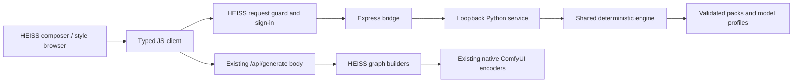

# HEISS Studio integration

PromptStyler Next supplies a running local style workbench, a Python HTTP service,
a browser client with TypeScript declarations, and an Express-compatible bridge.
JavaScript only carries recipes and results: the Python engine owns composition,
conflict resolution, model adapters, and catalog search.

## Architecture choice

The HEISS audit used upstream `tristmeister/HEISS-UI` at
[`871e1934cbe03153499fa05ec79747b3173f2999`](https://github.com/tristmeister/HEISS-UI/tree/871e1934cbe03153499fa05ec79747b3173f2999)
(version 0.18.1). Its browser is React/TypeScript with Vite; its local server is
Express 5 ESM. `server/index.js` owns `/api/generate`, request-origin guards and
sign-in. `src/app/useGenerationActions.ts` constructs a body containing `prompt`,
`negative`, `profileId`, `model`, and `workflow` before calling that endpoint.
`server/graphs.js` maps that body into native or imported ComfyUI graphs.

HEISS does not expose a general third-party style plugin loader. A small explicit
server mount and an optional composer panel are therefore the integration points.
This repository leaves the installed HEISS files untouched. It does not inject
scripts, replace graph builders, or patch minified release assets.



## Run the workbench independently

After installing the Python package:

```sh
promptstyler-next serve --port 8791
# Equivalent standalone transport entry:
python -m promptstyler_next.service --port 8791
# Explicit trusted-local pack paths, not uploads:
python -m promptstyler_next.service --pack ./my-pack.json --port 8791
```

Open `http://127.0.0.1:8791`. Search and filter the catalog, save favorites, combine
ordered styles, adjust intensity, protect axes, and inspect the composed prompt.
Export/import recipes to reproduce a configuration. Favorites alone are saved in
browser storage; prompts, recipes and output text are not persisted by the service.

The workbench supports loading, empty, failure, stale-output, and successful result
states. It uses native labelled controls, keyboard focus indicators, reduced-motion
handling and a narrow-screen layout. Palette swatches are abstract identification
aids, explicitly labelled as such. They are **not generated model previews** and
are not evidence of image quality. User-provided pack preview paths are metadata;
the HTTP service never turns them into file-serving routes.

## Mount in a HEISS source checkout

Keep this repository available beside the HEISS source. In `server/index.js`,
import the bridge, then mount it **immediately after** the existing `requestGuard` and **before**
`express.json(...)`, using the existing hoisted `requireSignedIn` function:

```js
import { createPromptStylerBridge } from '../../ComfyUI-PromptStyler-Next/studio/bridge.mjs';

// Existing HEISS requestGuard is immediately above this mount.
app.use('/api/promptstyler/v1', requireSignedIn, createPromptStylerBridge({
  upstream: 'http://127.0.0.1:8791',
  timeoutMs: 5000,
}));
// Existing express.json(...) and global requireSignedIn stay below for other routes.
```

The example relative import assumes sibling project directories; adapt it to your
checkout layout. The bridge has no npm dependencies. It accepts only a fixed
loopback upstream, forwards the documented style routes, drops browser cookies and
authorization headers, limits JSON to 128 KiB and responses to 2 MiB, and reports
bounded timeout/unavailable errors. It must run behind HEISS's existing access
guards and before JSON body parsing. Python validates the original JSON bytes,
including duplicate-key rejection. An already-parsed body returns an actionable
`bridge_mount_order` error; move the guarded mount above `express.json(...)`. It is not an authentication provider or a network-facing standalone proxy.
The sidecar binds only IPv4 loopback and rejects foreign Host/Origin headers.

## Connect a composer panel

The same client is usable in a React panel or a plain browser module:

```ts
import { PromptStylerClient, styleGenerationBody } from '../../ComfyUI-PromptStyler-Next/studio/client.mjs';

const styler = new PromptStylerClient({ baseUrl: '/api/promptstyler/v1' });
const { items: profiles } = await styler.profiles();
const { items: styles } = await styler.styles({ q: 'ink', model: 'anima' });
const imported = await styler.composeJson(rawRecipeFileText); // raw bytes retain duplicate-key validation
const suggestions = await styler.recommend({ prompt: 'a rainy street', model: 'flux' });
```

Place a panel beside the HEISS prompt composer, using the returned style names,
categories, descriptions, tags and preview metadata. Keep selected layer IDs,
intensities and order in the panel's state. Obtain model capabilities from
`profiles()`; do not infer them from filename substring matching.

At the fresh-generation boundary in `useGenerationActions.ts`, after building the
request body and **before** its existing `/api/generate` call:

```ts
// Explicit mapping belongs to the host's selected model/profile UI.
const selectedStylerProfile = 'flux';
const selectedLayers = [{ id: 'cinema.noir', intensity: 0.75 }]; // use catalog IDs
const { body: styledBody, composition } = await styleGenerationBody(styler, requestBody, {
  schema_version: 1,
  model: selectedStylerProfile,
  styles: selectedLayers,
  conflict_policy: 'last_wins',
  locked_axes: [],
});
// Pass styledBody to HEISS's existing apiJson('/api/generate', ...) call.
// Keep composition.recipe/fingerprint alongside panel state if you want replay.
```

Use an ID actually returned by the catalog. The helper preserves every other
request field and does not mutate the input. Apply styling **once** to a fresh
request. HEISS retry requests already contain their final prompt; do not style
those again. A simpler first integration is an explicit “Apply styled prompt”
action that sets the existing prompt/negative fields, followed by the unchanged
HEISS generation path.

For imported workflows with their own `promptComposition` prefix/suffix, preview
the final combined graph prompt and avoid applying the same style in both layers.
Keep conditioning in HEISS's existing family graph: styling does not authorize
replacing Qwen/MOSS/Anima/Fibo text encoders with a generic CLIP path. Fibo results
may be caption JSON; preserve that serialized model prompt as returned.

## HTTP contract

All JSON responses use UTF-8, `Cache-Control: no-store` and no permissive CORS.
The sidecar has no write, model download, pack upload, generation or filesystem
browser endpoints.

| Method | Sidecar path | Result |
| --- | --- | --- |
| GET | `/api/v1/health` | Status, schema version, catalog fingerprint |
| GET | `/api/v1/catalog` | Total, categories, kinds, catalog fingerprint |
| GET | `/api/v1/profiles` | `{items: ModelProfile[]}` |
| GET | `/api/v1/styles` | `{items: StyleMetadata[], catalog_fingerprint}` |
| GET | `/api/v1/styles/{id}` | Full validated style metadata |
| POST | `/api/v1/compose` | Composition result |
| POST | `/api/v1/recommend` | `{items: ScoredStyle[]}` |

Style query fields: `q`, `category`, `model`, repeatable `tag`, `kind`, `limit`,
`offset`. Unknown/repeated scalar fields fail. The catalog is immutable for the
service lifetime: restart with a newly validated pack snapshot after editing packs.
Errors have `{error: {code, message, path}}`. Invalid input is HTTP 400; unknown
style detail is 404; foreign origins/hosts are 403; oversized JSON is 413. The
HEISS bridge adds HTTP 502/504 for unavailable/timed-out sidecars.

`studio/client.d.ts` and `studio/bridge.d.ts` describe the transport exports.
Recommendations rank literal metadata matches; they do not claim model quality
prediction or semantic understanding by a language model.

## Validation and limits

`tests/test_service.py` exercises real HTTP/catalog/engine parity, model profiles,
recommendations, strict JSON, request limits, static-asset containment and
Host/Origin rejection. `node --test studio/tests/*.test.mjs` verifies middleware,
client behavior, generation body preservation, timeouts, limits, and a real Python
sidecar round trip. Set `PROMPTSTYLER_PYTHON` when its interpreter is not `python3`.

A maintainer must opt into the small HEISS source mount/panel change. This package
does not claim that a particular installed or upstream HEISS release already
ships that mount. Image-generation quality and live authenticated HEISS generation
remain separate acceptance checks from transport and text-composition correctness.
