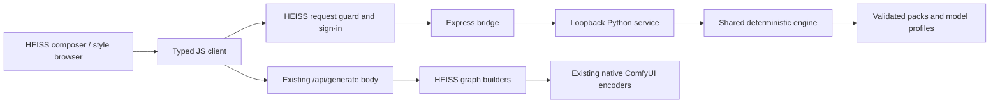

# HEISS Studio integration

PromptStyler Next supplies a running local style workbench, a Python HTTP service,
a browser client with TypeScript declarations, and an Express-compatible bridge.
JavaScript only carries recipes and results: the Python engine owns composition,
conflict resolution, model adapters, and catalog search.

## Architecture choice

The HEISS audit used upstream `tristmeister/HEISS-UI` at
[`871e1934cbe03153499fa05ec79747b3173f2999`](https://github.com/tristmeister/HEISS-UI/tree/871e1934cbe03153499fa05ec79747b3173f2999)
(version 0.18.1). Its browser is React/TypeScript with Vite; its local server is
Express 5 ESM. `server/index.js` owns `/api/generate`, request-origin guards and
sign-in. `src/app/useGenerationActions.ts` constructs a body containing `prompt`,
`negative`, `profileId`, `model`, and `workflow` before calling that endpoint.
`server/graphs.js` maps that body into native or imported ComfyUI graphs.

HEISS does not expose a general third-party style plugin loader. A small explicit
server mount and an optional composer panel are therefore the integration points.
The reusable modules support a source integration. The reviewed local release
integration also uses an exact-SHA256 guarded asset patch; unknown frontend versions
fail safely and require a fresh review. It does not replace native graph builders.



## Run the workbench independently

After installing the Python package:

```sh
promptstyler-next serve --port 8791
# Equivalent standalone transport entry:
python -m promptstyler_next.service --port 8791
# Explicit trusted-local pack paths, not uploads:
python -m promptstyler_next.service --pack ./my-pack.json --port 8791
```

Open `http://127.0.0.1:8791`. Search and filter the catalog, save favorites, combine
ordered styles, adjust intensity, protect axes, and inspect the composed prompt.
Export/import recipes to reproduce a configuration. Favorites alone are saved in
browser storage; prompts, recipes and output text are not persisted by the service.

The workbench supports loading, empty, failure, stale-output, and successful result
states. It uses native labelled controls, keyboard focus indicators, reduced-motion
handling and a narrow-screen layout. Palette swatches are abstract identification
aids, explicitly labelled as such. They are **not generated model previews** and
are not evidence of image quality. User-provided pack preview paths are metadata;
the HTTP service never turns them into file-serving routes.

## Mount in a HEISS source checkout

Keep this repository available beside the HEISS source. In `server/index.js`,
import the bridge, then mount it **immediately after** the existing `requestGuard` and **before**
`express.json(...)`, using the existing hoisted `requireSignedIn` function:

```js
import { createPromptStylerBridge } from '../../ComfyUI-PromptStyler-Next/studio/bridge.mjs';

// Existing HEISS requestGuard is immediately above this mount.
app.use(requireSignedIn); // Global, so req.path retains /api/... for access decisions.
app.use('/api/promptstyler/v1', createPromptStylerBridge({
  upstream: 'http://127.0.0.1:8791',
  timeoutMs: 5000,
}));
// Existing express.json(...) follows. Remove the old later global auth mount.
```

The example relative import assumes sibling project directories; adapt it to your
checkout layout. The bridge has no npm dependencies. It accepts only a fixed
loopback upstream, forwards the documented style routes, drops browser cookies and
authorization headers, limits JSON to 128 KiB and responses to 2 MiB, and reports
bounded timeout/unavailable errors. It must run behind HEISS's existing access
guards and before JSON body parsing. Python validates the original JSON bytes,
including duplicate-key rejection. An already-parsed body returns an actionable
`bridge_mount_order` error; move the guarded mount above `express.json(...)`. It is not an authentication provider or a network-facing standalone proxy.
The sidecar binds only IPv4 loopback and rejects foreign Host/Origin headers.

## Connect a composer panel

The same client is usable in a React panel or a plain browser module:

```ts
import { PromptStylerClient, styleGenerationBody } from '../../ComfyUI-PromptStyler-Next/studio/client.mjs';

const styler = new PromptStylerClient({ baseUrl: '/api/promptstyler/v1' });
const { items: profiles } = await styler.profiles();
const { items: styles } = await styler.styles({ q: 'ink', model: 'anima' });
const imported = await styler.composeJson(rawRecipeFileText); // raw bytes retain duplicate-key validation
const suggestions = await styler.recommend({ prompt: 'a rainy street', model: 'flux' });
```

Place a panel beside the HEISS prompt composer, using the returned style names,
categories, descriptions, tags and preview metadata. Keep selected layer IDs,
intensities and order in the panel's state. Obtain model capabilities from
`profiles()`; do not infer them from filename substring matching.

## Native panel and generation integration

`createPromptStylerPanel(React)` from `studio/react-panel.mjs` uses the host's React
instance. Mount it beside the prompt field with `{profile, prompt, negative, mode}`
and load `studio/panel.css`. The compact Styles button opens a native modal browser
with **Looks**, **Color**, **Effects**, **Saved** and **Presets** sections. Search names, descriptions,
collections and tags; browse the complete compatible catalog, including pages beyond
1,000 entries. **New additions** highlights the 15 community packs and the four
semantic-base toolkit packs (332 entries before model/type filtering).

Choose one look and one color grade by default: another choice replaces that type
while retaining finishing effects. Click a selected card again to remove it. Selected
styles appear as removable chips beside the original prompt; **Apply** pauses or
resumes them. The **Your look** panel provides strength and a text preview. Under
**Advanced controls**, opt into free mixing, reorder layers, override the model or
protect prompt attributes. The recipe limit remains 16 layers. Strength changes
which authored prompt clauses participate; it is not a diffusion/LoRA weight.

The desktop browser has a library and a separate selection panel. On phones it uses
the full viewport, two card columns, a collapsible selection section above the library,
a single main scroll area and a fixed Done action. Native dialog behavior traps focus,
supports Escape and returns focus to the launcher. Color cues are abstract identifiers,
not generated examples or promises about output appearance.

Selections are remembered per workflow profile in this browser, including pause state,
strengths, layer order and advanced controls. Favorites retain the existing storage key.
Save a named combination in **Your look**, then apply or delete it in **Presets**. Up to
40 combinations are kept; saving the same name updates it. A preset preserves whether
the saved selection was paused. These recipes contain style
settings, not prompt text or images. Storage failures preserve the current session.

Search accepts multiple words in any order and ignores accents. Sort by featured
entries, name, or favorites first. The compatible catalog is cached for the page
lifetime; reopening is instant after the first load. Retry invalidates that cache.
Catalog search and browsing run only in the UI, outside model execution.

The browser applies choices immediately; Done returns to the composer. Preview never
replaces the typed prompt. Empty or disabled recipes leave generation unchanged.
Video profiles hide styling. Catalog failures offer retry without dropping selections.

At fresh request creation, add `promptStyler: studioPromptStylerSelection(profile)`.
Keep the original prompt editable. Do not re-run this selection step on retry bodies.
For image-setting replay, call `restoreStudioPromptStylerSelection(profile, recipe)`
before generating; passing no recipe clears styles. Restoration preserves ordered
strengths and engine options, validates the 16-layer shape atomically and notifies all
mounted panels. Catalog membership is checked by the engine during composition.
`getStudioPromptStylerState(profile)` captures the full browser state, including
paused and free-mixing controls; `restoreStudioPromptStylerState(profile, state)`
validates and restores that state atomically. Style selections, favorites and presets
also follow browser storage events, keeping tabs synchronized on the same origin.
`studio/model-profile.mjs` maps explicit HEISS family/capability metadata to engine
profile IDs; it contains no prompt formatting algorithms.

`createManagedPromptStyler` from `studio/server.mjs` lazily starts one owned Python
service on an ephemeral loopback port. Configure its Python interpreter and project
root explicitly. Mount `.middleware` behind global host guards and before JSON
parsing. Use `.compose(recipe)` to validate and normalize generation recipes.
Call `.stop()` from host signal handlers and `.close()` during async teardown.
An unavailable interpreter produces an actionable request error.

For custom workflows, invoke `injectPromptStyler(graph, workflow, body)` from
`studio/graph.mjs` after normal mapped inputs and before submission. The target is
`workflow.promptStyler` (a `{node,input,model}` metadata entry), or `controls.prompt`.
It inserts one `PSNextCompose` between the mapped string/link and its native encoder.
A mapped negative input can consume output 1. The host checks that the node exists
before submission. Each retry starts with a fresh saved graph, preventing accumulation.
For built-in graphs, compose the actual prompt on the server once and remove the
recipe from the final retry body. Keep all native conditioning and sampler paths.

The reviewed Studio installation supports these saved workflows:

| Workflow | Profile | Styling location |
| --- | --- | --- |
| Anima Image Clone | `anima-turbo` | After the image captioner, before native text encoding |
| MOSS Flash / Detail | `moss-image-dmd` | Native positive prompt input, CFG 1 |
| Fibo 2 Edit Turbo | `fibo-edit` | Native edit instruction input |

Anima preview displays style directions; the image caption is only available during
generation. Fibo edit preserves plain instructions or existing caption JSON without
inventing scene entities. Selected profiles do not change model weights, sampling,
LoRAs or workflow mode. Automatic launcher update checks remain disabled.

## HTTP contract

All JSON responses use UTF-8, `Cache-Control: no-store` and no permissive CORS.
The sidecar has no write, model download, pack upload, generation or filesystem
browser endpoints.

| Method | Sidecar path | Result |
| --- | --- | --- |
| GET | `/api/v1/health` | Status, schema version, catalog fingerprint |
| GET | `/api/v1/catalog` | Total, categories, kinds, catalog fingerprint |
| GET | `/api/v1/profiles` | `{items: ModelProfile[]}` |
| GET | `/api/v1/styles` | `{items: StyleMetadata[], catalog_fingerprint}` |
| GET | `/api/v1/styles/{id}` | Full validated style metadata |
| POST | `/api/v1/compose` | Composition result |
| POST | `/api/v1/recommend` | `{items: ScoredStyle[]}` |

Style query fields: `q`, `category`, `model`, repeatable `tag`, `kind`, `limit`,
`offset`. Unknown/repeated scalar fields fail. The catalog is immutable for the
service lifetime: restart with a newly validated pack snapshot after editing packs.
Errors have `{error: {code, message, path}}`. Invalid input is HTTP 400; unknown
style detail is 404; foreign origins/hosts are 403; oversized JSON is 413. The
HEISS bridge adds HTTP 502/504 for unavailable/timed-out sidecars.

`studio/client.d.ts` and `studio/bridge.d.ts` describe the transport exports.
Recommendations rank literal metadata matches; they do not claim model quality
prediction or semantic understanding by a language model.

## Validation and limits

`tests/test_service.py` exercises real HTTP/catalog/engine parity, model profiles,
recommendations, strict JSON, request limits, static-asset containment and
Host/Origin rejection. `node --test studio/tests/*.test.mjs` verifies middleware,
client behavior, generation body preservation, timeouts, limits, and a real Python
sidecar round trip. Set `PROMPTSTYLER_PYTHON` when its interpreter is not `python3`.

The local installed HEISS integration was checked in an isolated copy of its actual
release UI, including the Generate request payload, all three saved graph routes,
and a model-free linked-caption execution in ComfyUI. Upstream HEISS does not ship
this panel by default. Full image generation and perceptual quality remain separate
acceptance checks; browser transport checks do not prove them.
