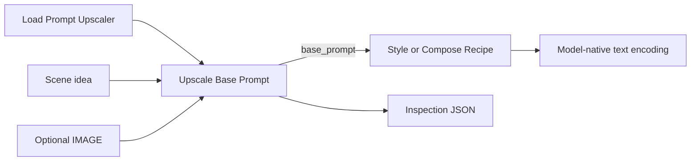

# Fast local base-prompt upscaling

The optional ComfyUI authoring stage accepts a scene idea, one RGB image, or both.
The experimental [LFM3-VL route](lfm3-vl.md) adds complete prompt rewriting for
MOSS Image Base and Anima. The MiniCPM behavior described below remains available.
Version 0.4.1 adds **Expanded** (default) and **Faithful** detail modes. Expanded
text continues your complete original scene with useful physical detail instead
of paraphrasing it. Faithful asks for concise clarification.

It distills the [semantic-base toolkit](../llm-prompts/README.md) into a compact,
versioned inference contract and examples. Connect its **base_prompt** STRING to
**Style → prompt** or **Compose Recipe → prompt**, then use your model's native
encoder as usual.

## Setup and controls

Use the existing self-contained artifact
`models/anima_prompt_architect/minicpm-v4.7-1b-heretic-int8-convrot.safetensors`.
Refresh the model list and select it in **PromptStyler Next: Load Prompt Upscaler**.
No PixAI model, Anima Prompt Architect installation, internet access, Hugging Face
cache or separate tokenizer directory is needed. The artifact's embedded assets
are validated and read as data; pinned local code supplies the implementation.
The raw upstream checkpoint has a different deployment layout and cannot be
substituted directly. This version supports the packaged MiniCPM-V 4.7 **1B**
architecture with 137 native INT8 ConvRot projections and retained BF16 tensors.

The optional runtime requires the native CUDA/Kitchen backend and Transformers'
Qwen3.5/MiniCPM4.6 support, plus the host's Torch, Tokenizers, Safetensors,
Accelerate and Pillow. Tested with Torch 2.11.0+cu130, Transformers 5.15.1 and
Comfy Kitchen 0.2.40. MiniCPM4.7 configuration/model/processor code is vendored
from Transformers v5.19.0; see [NOTICE](../NOTICE). There is no automatic download
or dependency upgrade. Unsupported hosts fail with a diagnostic when loading;
ordinary style nodes and the standalone engine continue to work independently.
CPU inference is not supported for this accelerated deployment.

1. Add **Load Prompt Upscaler**, **Upscale Base Prompt**, and **Style**.
2. Connect `upscaler` to `upscaler`, then `base_prompt` to Style's `prompt`.
3. Enter a simple idea, connect Load Image's IMAGE output, or do both. Empty text
   is valid with an image. With both inputs, text requirements take precedence.
4. Preview `base_prompt` and `inspection`, select your style and generation profile.

Import [the visual workflow](../examples/comfyui-upscaler-workflow.json) or use
[the executable API graph](../examples/comfyui-upscaler-api.json). Connect the
optional image socket for either image mode. The upscaler returns scene prose,
not Fibo JSON, sampler settings or conditioning, together with inspection JSON.

To present the result without creating a file, connect both output sockets to
**PromptStyler Next: Preview Base Prompt**. It is an output-only node: ComfyUI
history exposes the prompt in `text` and the inspection JSON in `inspection`.
Using this preview is optional and does not alter the normal image graph.

Detail and speed controls:

| Control | Default | Effect |
| --- | --- | --- |
| `detail_mode` | `expanded` | Expanded text preserves the complete source and adds up to three supporting details about existing subjects/actions. Faithful asks for minimal additions. Image/reference content stays grounded in the evidence in both modes. |
| `max_new_tokens` | 192 | Output budget, 32–2048; generation stops at EOS or a blank paragraph. In combined mode the grounding pass is capped at 128 and the rewrite uses this budget. |
| `image_slices` | 1 | Fastest image setting. Up to 4 allows detail crops at a time/VRAM cost; it does not improve image-generation resolution. |
| `offload_after` | false | Reuse the resident model for prompt edits. Enable to immediately release this model's VRAM after a request. ComfyUI can offload it automatically either way. |

Text is limited to 6,000 characters and each prepared pass to 4,096 tokens.
Images must be one RGB IMAGE of at most 16 megapixels; preprocessing limits the
long edge to 2,048 pixels before the model's own slice/resolution transform.
Split batches before this node. Fine lettering can require more slices, a crop
or a supplied transcription.

## Why the fast path is fast

The new mode widget is appended after the existing widgets, and API graphs may
omit it to use Expanded. Saved 128-token budgets remain valid; 192 is the default
for newly added nodes.

The loader is a separate cacheable V3 node. Changing prompt text or style does
not reconstruct its model. Unchanged upscaler inputs reuse ComfyUI's complete
node result, and changing only a style does not run the VLM again. Model file
size/mtime/inode changes invalidate the load handle. Disabling ComfyUI's node
cache defeats this reuse.

The runtime uses native mixed-precision operations, fused gate/up and QKV/Z
projections, Kitchen's fused recurrent DeltaNet decode, KV caching, greedy
sampling and disabled thinking. Paragraph termination matches token IDs on the
device; it avoids decoding the full generated prefix at every step. No
`torch.compile` warmup or mandatory heavyweight model dependency enters the core.

Expanded text pre-fills the assistant response with the supplied scene and a
sentence boundary, then generates its continuation. This keeps counts, exact
lettering, fantasy geometry and the original action intact instead of trusting a
free rewrite to retain them. It adds no extra generation pass. Existing aesthetic
instructions also survive in that source: neutralize a styled prompt with the
toolkit first. Faithful remains a model rewrite and can still omit facts.

Text-only and image-only use one generation. Combined input first grounds the
image, then rewrites that short description with the user's requirements. This
second short text pass corrected ignored changes and displaced unrelated objects
seen in single-pass trials. It shares the loaded model. Inspection exposes both
passes and the intermediate reference content so failures can be examined.

## Measured scope and limitations

Expanded text can add physical details while preserving the supplied scene, but
output length and latency vary with the input, model placement, output budget and
whether grounding or repair passes are needed. Faithful is available for concise
clarification. Reference modes may produce similar output in either detail mode:
visible evidence, rather than a word count, sets their detail. These checks do not
establish downstream diffusion image quality; no image-quality grid was run for
the MiniCPM continuation change.

This is a small VLM, not a semantic verifier. It can omit facts, invent details,
misread text or retain unwanted style language. Expanded continuation preserves the supplied bowl, its table, three lemons and
exact `雨` marking before adding detail. Faithful rewrites have omitted a table
in evaluation, and style-heavy input can retain artistic language with a warning.
Start with content-only ideas and inspect results. Use the toolkit's audit or
manual correction for strict content fidelity. This stage never establishes
image-generation quality or universal compatibility through a generated image.

Empty/reasoning output and changed quoted text fail explicitly. Token-limit and
limited style/edit-language checks appear in `warnings`; the style-language
check is a heuristic and can flag an actual painting depicted as an object.
Descriptions are not silently filtered. Expanded text explicitly includes the
original scene as its prefix; Faithful and reference output remain model-authored.
The greedy VLM output need not match across devices or dependency versions.
Save the accepted base text and recipe for reproducible deterministic styling.

Inspection includes model identity, contract/settings, token counts, individual
pass timings, warnings, reference content and final base. `source_preserved` and
`added_words` explain whether the accepted base contains a preserved text prefix
and how much continuation was generated. Small additions to short inputs produce
a warning instead of silently presenting a paraphrase as useful expansion. Cached results retain
the timing of their original computation. Runtime logs contain counts/timings,
not prompt text. There is no telemetry or VLM endpoint in the Studio service.

## Validation

Normal standalone tests exercise the compact contract and bounded embedded
archive reader without Torch. Host tests verify six V3 schemas, input modes,
placement, offload/error cleanup, stopping and file invalidation with doubles.
Real local tests queued all three input modes through native ComfyUI and Style,
verified reuse for identical requests and prompt edits, and compared small fused operations
against reference calculations. No diffusion model or generated-image quality
benchmark is included in this acceptance.

Run host contracts with ComfyUI on `PYTHONPATH`; run optional tiny CUDA tests with
`PSNEXT_RUN_CUDA_TESTS=1` and the actual host Python. They require no downloaded
weights. Use `scripts/benchmark_upscaler.py --help` for an existing-artifact speed
probe; it runs locally and prints the accepted outputs with timing diagnostics.
